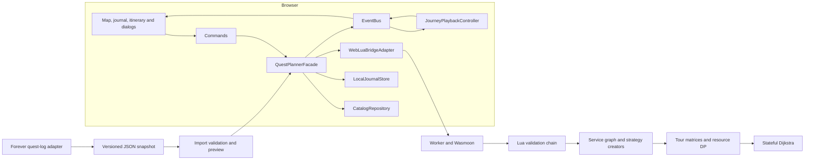
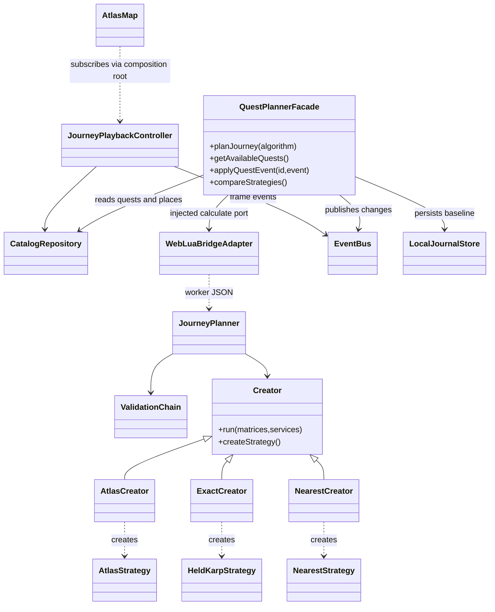
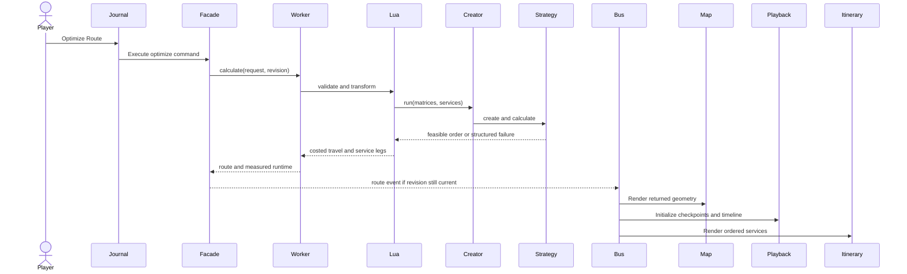
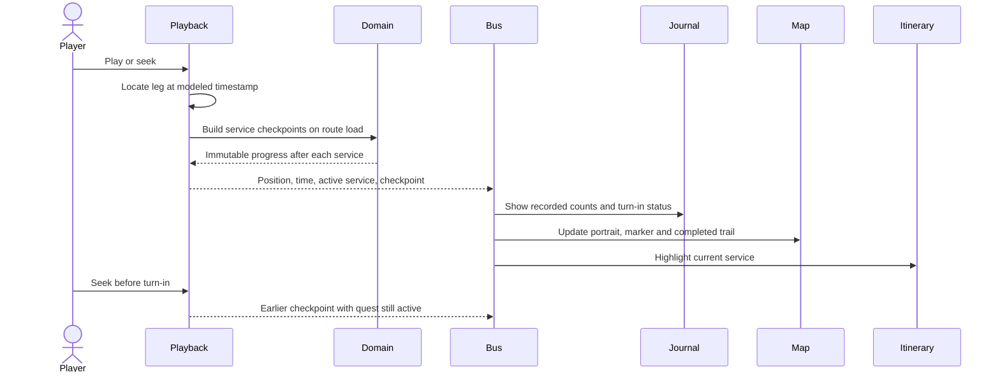

# Architecture and project audit

## Baseline and decisions

The inspected Wayfarer's Atlas revision was `33f6e8c4917510012108d77c884f68286a418dd5`. The original Atlas revision was `1748ccf77aca715ba49963f345f3689b911881e0`. The Claude artifact could not be opened. The repository supplied its browser template and built showcase. The SRS supplied priorities and acceptance criteria. Books and the preprint supplied design and algorithm guidance.

| Baseline finding | SRS status before this change | Decision |
|---|---|---|
| World, heap and resource-state Dijkstra; original Atlas regression fixtures | Existing weighted paths and reference coverage | Keep modules, data and Java-output fixtures. Add a Lua 5.1 bit fallback. |
| Tour stops and exact/heuristic optimization; omitted prerequisites assumed done | Partial FR-013, FR-022–024 | Reuse matrices, exact order DP and fixed-order resource DP. Add explicit prerequisite and reachability validation to the new workflow. |
| Exact failure could pass a nil order to reconstruction; heuristic could append an unavailable stop | Missing structured failure for the new route contract | Check reachability and returned order before constructing a new result. Preserve legacy showcase and tests separately. |
| Atlas participated in flight-network edge coverage | Missing FR-021 for quest optimization | Implement required services and bounded Atlas-guided route extensions in the main planner. |
| Browser template combined controls, painting and animation; VM loaded remotely | Partial map, playback and offline support | Keep the original showcase and add a worker with locally bundled Wasmoon, DOM-free controller and explicit service events. |
| Manual addon quests, sample log and chat output | Missing actual quest counts and offline import | Add a separate read-only quest-log adapter and versioned JSON preview. |
| No coursework matrix, full traceability or cross-runtime quest-service proof | Missing GOAL-06 and T-18 evidence | Add executable contracts, parity captures, browser scenarios, diagrams and traceability. |

Work followed dependencies: source audit, typed-by-convention request/result contracts, service construction, Lua strategies, worker, facade, simulation, renderer, integration tests and documentation. The separate original-mode path retains its historical behavior.

### Architecture decisions

- **ADR-001.** The same Lua planner supports native Lua and Wasmoon. A bundled locally served worker keeps the browser responsive. No parallel JavaScript routing implementation needs to be maintained.
- **ADR-002.** An activity is a guarded service transition at a physical location. Time spent traveling and time spent performing a service have separate records.
- **ADR-003.** A bit mask models globally consumed one-use abilities. A matrix entry retains results per mask, with resource reuse forbidden across legs.
- **ADR-004.** An explicit JSON snapshot crosses the addon/web boundary. The original client log is preserved separately from manually assigned points and simulated progress.
- **ADR-005.** The teaching map, portrait and landscape are original generated illustrations. Local OFL fonts and ISC/MIT icons supply the user interface. Upstream game references remain attributed.
- **ADR-006.** Only completed bounded subset-DP results receive a model-optimal proof flag. Unsupported cases remain visible as bounded-out comparisons.

## Component diagram

## Class diagram

Creator names in this diagram denote specialized Lua objects in `Planner.creators`. Their inherited `run` method dispatches to their own `createStrategy` callback. The registry selects a creator by request ID. The creator's overridable method constructs the product.

## Sequence diagrams

### Optimize Route

### Quest completion and backward seek

## Principles and patterns

| Principle or pattern | Collaborators and responsibility | Verification and extension |
|---|---|---|
| Single Responsibility | `domain.mjs` changes quest state; `planner.lua` constructs routes; `map.mjs` paints; `playback.mjs` selects a timeline checkpoint; `snapshots.mjs` validates import. | DOM-free controller tests replay a route without rendering. Map changes do not require a new routing implementation. |
| Open/Closed | The planning service accepts an injected creator table. Directed transport edges carry a mode, seconds and gates. Existing generic transport handling accepts an enabled mode with these fields. | The creator-override test exercises an extra factory product. Adding a special resource-consuming spell requires a resource declaration and presentation mapping. |
| Liskov Substitution | All routing creators return an eligible order or a failure through the common plan/result boundary. The exact strategy documents and reports its finite search bound. | One contract suite iterates all three strategies on empty, feasible, precedence and disconnected inputs. A view can render any successful result. |
| Interface Segregation | Repository lookups, `router.calculate`, `store.save`, `bus.on/emit` and playback state are independent structural ports. | Facade tests use a single-method router and store. The playback test omits storage and the worker entirely. |
| Dependency Inversion | `QuestPlannerFacade` receives repository, router, store and bus. Browser construction occurs in `app.mjs`. Shared Lua receives graph/profile records and optional creators. | Fake collaborators test stale responses and commands. The same Lua input runs without a browser or WoW. |
| Chain of Responsibility | `Planner.chain` calls selection, coordinate, prerequisite, transport and reachability handlers in order. A failure stops dispatch. | Sentinel test proves the third handler is skipped; routing tests verify permission and blocked-ID reports. Validators can be inserted independently. |
| Factory Method | Specialized creator objects override `createStrategy`, while inheriting `Creator.run` through a Lua metatable. | Override test creates a different product and observes its result through inherited dispatch. The caller has no algorithm construction branches. |
| Strategy | Atlas-guided lookahead, bounded Held–Karp, and nearest eligible service implement the same ordering interface. | Contract and comparison tests invoke every strategy. The adapter, playback and map share their result type. |
| Facade and Service Layer | `QuestPlannerFacade` assembles requests, compares strategies, invalidates stale routes and exposes intent-level operations. `JourneyPlanner.plan` coordinates validation, construction and reconstruction. | Facade integration and browser tests exercise the UI entry points. Views need no knowledge of spent-resource masks. |
| Command | `Commands.optimize/reset/ignore/mark` capture arguments and expose `execute(facade)`. The UI invokes them for the corresponding actions. | Command test exercises all four against injected dependencies and checks selection history and emitted events. |
| Observer / Domain Events | `EventBus` delivers journal, route, calculating, progress and frame notifications. The frame projection supplies checkpoint, pose and time together. | Observer and playback tests inspect published results; browser tests assert tracker and map transitions. Listeners may subscribe without altering the planner. |
| Repository | `CatalogRepository` exposes records and locations. The composition root adds normalized imported rows to the local catalog. | Tests replace the full repository with a one-quest collection; client import exercises a second source. |
| Adapter | `WebLuaBridgeAdapter` correlates worker calls; `ui/snapshot.lua` translates supported client fields; `previewImport` validates imported schemas and projected data. | Native/worker parity, stub quest-log capture and real browser import tests verify the boundaries. Version-specific APIs stay outside routing. |

Shvets' pattern roles guide the creator/product, command and chain designs. Percival and Gregory's repository, service-layer, events and composition-root approach is applied without introducing a server, database or distributed message bus. See [source reading notes](source-review.md).

