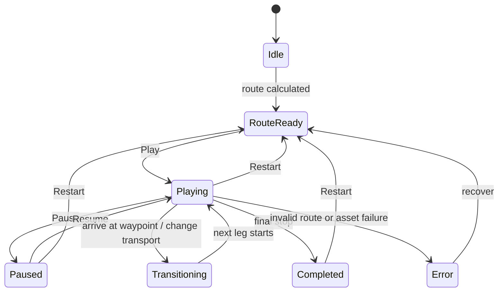
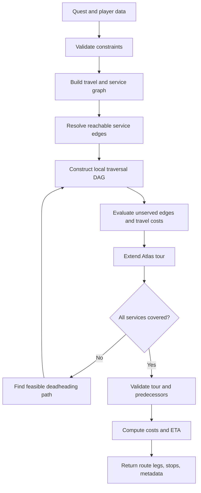
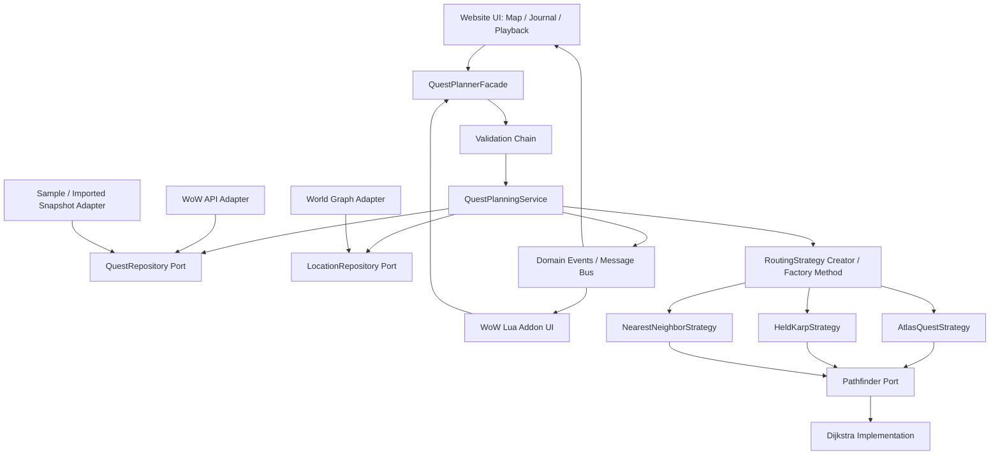

# Wayfarer's Atlas — Website, Quest Tracker & Animated Route Planner

**Software Requirements Specification (SRS), UI/UX Design Brief, and Engineering Plan**  
**Version:** 1.0 — 21 November 2026  
**Status:** Proposed implementation requirements; not a claim that all features already exist  
**Target:** World of Warcraft: Forever companion website, with a compatible in-game Lua addon  
**Primary architectural constraints:** SOLID, GoF design patterns, testable domain logic, and an Atlas-based routing mode

> **Purpose.** Build an intuitive, attractive, game-inspired interactive website where a player can view their quests, see a richly styled world map, generate an efficient route, watch an animated character traverse it, and understand every quest and travel action. The underlying planner must be explainable, testable, and consistent with the World of Warcraft: Forever Lua addon.
>
> **Source fidelity.** Sections marked **[SOURCE]** summarize the referenced repositories or PDFs. Sections marked **[REQUIREMENT]** or **[DESIGN PROPOSAL]** define what *should* be built; they are not claims about the current code. The Claude-hosted artifact URL could not be inspected directly in this review; design references to the existing site come from the repository's README and `web/template.html`.

---

## Contents

1. [Project scope and success criteria](#1-project-scope-and-success-criteria)
2. [Source material and current baseline](#2-source-material-and-current-baseline)
3. [User journeys and information architecture](#3-user-journeys-and-information-architecture)
4. [Detailed website functional requirements](#4-detailed-website-functional-requirements)
5. [Visual design system and game-inspired art direction](#5-visual-design-system-and-game-inspired-art-direction)
6. [Map design, path visualization, and controls](#6-map-design-path-visualization-and-controls)
7. [Character movement and animation specifications](#7-character-movement-and-animation-specifications)
8. [Quest tracker, route itinerary, and UX behavior](#8-quest-tracker-route-itinerary-and-ux-behavior)
9. [Graph model and Atlas route optimization](#9-graph-model-and-atlas-route-optimization)
10. [Architecture, SOLID, and design patterns](#10-architecture-solid-and-design-patterns)
11. [Data contracts, website/addon synchronization, and compatibility](#11-data-contracts-websiteaddon-synchronization-and-compatibility)
12. [Quality attributes, security, privacy, and accessibility](#12-quality-attributes-security-privacy-and-accessibility)
13. [Testing and objective acceptance criteria](#13-testing-and-objective-acceptance-criteria)
14. [Implementation plan and deliverables](#14-implementation-plan-and-deliverables)
15. [Source traceability and references](#15-source-traceability-and-references)

---

## 1. Project scope and success criteria

### 1.1 Vision

**[REQUIREMENT]** The website must feel like a World of Warcraft adventurer's navigation journal rather than an ordinary logistics dashboard. In under one minute, a first-time visitor should be able to select a sample character, choose quests, press **Optimize Route**, and watch a clearly labeled player avatar travel between quest objectives on the map.

The website and addon serve different but complementary purposes:

- **Website / visual simulator:** rich responsive map, optional imported quest data, planned routes, interactive quest list, step-by-step and animated travel playback, algorithm comparison, and teaching/debugging views.
- **In-game Lua addon:** obtains permitted quest/character information from the client, displays a compact tracker, calculates or consumes the same type of route result, persists SavedVariables, and handles relevant events.
- **Shared domain and route logic:** single set of algorithm semantics. Prefer reusing the existing portable Lua planner in both surfaces; any platform adaptation must preserve behavior through contract tests.

### 1.2 Explicit goals

| ID | Priority | Requirement | Acceptance evidence |
|---|---|---|---|
| GOAL-01 | P0 | Quest selection, objective status, and player profile are usable without programming knowledge | A user plans a sample journey from the landing screen |
| GOAL-02 | P0 | A visible map shows quest locations, current position, route order and travel modes | Screenshot/video and UI test |
| GOAL-03 | P0 | A route can be calculated using an **Atlas-derived quest routing mode**, with a clearly described transformation from quests to required graph services | Algorithm documentation and automated tests |
| GOAL-04 | P0 | Animated player movement follows the returned route consistently | Playback and route-coordinate tests |
| GOAL-05 | P0 | Tracker and map stay synchronized during simulated progress | Integration test |
| GOAL-06 | P0 | Core software explicitly applies all five SOLID principles and required patterns | Code, UML, test evidence |
| GOAL-07 | P0 | The website distinguishes **estimated efficient routes** from mathematically proven shortest routes | Visible algorithm/method labels |
| GOAL-08 | P1 | Site can import validated quest-progress snapshots from the addon | Import fixture and test |
| GOAL-09 | P1 | Algorithm comparison explains cost, time, coverage and route differences | Comparison panel and benchmarks |
| GOAL-10 | P1 | Website is responsive, keyboard operable and offers reduced-motion playback | Accessibility test |

### 1.3 Non-goals and prohibited assumptions

- Do **not** promise continuous, live browser-to-WoW addon communication. Ordinary WoW Lua addons have sandboxed capabilities and do not establish arbitrary outbound web connections. Import/export should be explicit and offline unless a separate permitted integration is documented.
- Do **not** claim that the game exposes every quest objective's world coordinates. Use a validated quest-location dataset where the client API is insufficient.
- Do **not** call an Atlas heuristic "globally shortest" without proof; present cost as an estimate and compare against exact baselines on appropriately small examples.
- Do **not** automatically move or control a player's character in the game. The website animation is a **visual simulation**, not game automation.
- Do **not** bundle proprietary Warcraft maps, logos, UI textures, music, character sprites, or fonts unless the rights to use and distribute those assets are verified. A stylistic interpretation with original assets is sufficient.
- Do **not** represent uncertain beta-era travel connections or travel times as verified facts.

### 1.4 Priority definitions

**P0** = essential for a defensible working assignment; **P1** = strong enhancement; **P2** = optional polish. P0 features must be demonstrable without a live game client using deterministic sample data; a separate client validation is needed to claim in-game compatibility.

---

## 2. Source material and current baseline

### 2.1 Required sources

**[SOURCE]** The implementation and theory should use all of the following, with attribution:

1. **Savaş Takan, Atlas Java reference:** [github.com/savastakan/atlas](https://github.com/savastakan/atlas). This is a graph edge/traversal-coverage heuristic, not a native quest optimizer. Files include `Atlas.java`, `Graph.java`, `Edge.java`, `Main.java` and `Util.java`.
2. **Existing Wayfarer's Atlas implementation:** [github.com/tugra8005/wayfarers-atlas](https://github.com/tugra8005/wayfarers-atlas), especially `AtlasRoute/core/atlas.lua`, `core/tour.lua`, `core/router.lua`, `core/world.lua`, `core/coverage.lua`, `ui/addon.lua`, `web/template.html`, `web/bridge.lua`, `tests/` and the README.
3. **Atlas research PDF uploaded by the user:** *Benchmarking Atlas: A High-Performance Heuristic for Large-Scale Arc Routing Problems* (Kabaca, Samir and Takan), especially §3 Methodology, §3.1 Local DAG, §3.2 Optimizations and Algorithm 1 on PDF pages 3–4. The uploaded version identifies itself as a **preprint not peer reviewed**; do not treat performance claims as universal guarantees.
4. **Alexander Shvets, _Dive Into Design Patterns_, uploaded PDF:** SOLID (printed pp. 51–70); Factory Method (~p. 74), Adapter (~150), Facade (~211), Chain of Responsibility (~251), Command (~269), Observer (~337), Strategy (~369).
5. **Harry Percival & Bob Gregory, _Architecture Patterns with Python_, uploaded PDF:** Ch. 1 domain modeling; Ch. 2 Repository; Ch. 4 Service Layer; Ch. 5 TDD; Ch. 8 events/message bus; Ch. 10 commands and handlers; Ch. 13 dependency injection. Ideas are portable to Lua/JavaScript even though the book's code is Python.
6. **User-supplied Claude artifact:** [claude.ai/artifact/WvbojRiKXpqAH34kraFgXh](https://claude.ai/artifact/WvbojRiKXpqAH34kraFgXh). Direct live access was restricted at review time; inspect the published artifact interactively when available, and use the repository's `web/template.html` as the accessible implementation source meanwhile.

### 2.2 Baseline capabilities to preserve

**[SOURCE: Wayfarer's Atlas README]** The repository describes a Lua-based multi-modal route graph, quest-tour ordering with Held–Karp and heuristic methods, state-aware Dijkstra, Atlas edge coverage, weighted Atlas, a browser showcase using the same Lua logic via Wasmoon/WebAssembly, and animated travel modes. Its current quest-selection workflow is partly manual/demo-driven; actual automatic quest log and objective-location integration has not been verified in the live game.

**[REQUIREMENT]** Refactor rather than discard useful components. Preserve tested algorithm behavior, add an explicit quest-route Atlas mode, and isolate technology-specific concerns. Existing method implementations must continue to pass their established tests unless a documented defect is corrected with corresponding regression tests.

### 2.3 Meaning of "Chain of Command"

**[REQUIREMENT]** The classic GoF patterns are **Chain of Responsibility** and **Command** — separate patterns. To remove ambiguity in the assignment, **implement and demonstrate both**, not an invented hybrid called "Chain of Command."

---

## 3. User journeys and information architecture

### 3.1 Primary personas

- **First-time player:** unfamiliar with algorithms; wants to know what to do next and where to go.
- **Returning player:** imports quest status or resumes a previously planned journey.
- **Course evaluator/developer:** opens an algorithm explanation, toggles routing strategies, inspects a reproducible test scenario, and sees design-pattern evidence.

### 3.2 Main navigation

**[DESIGN PROPOSAL]** Use a single-page application with these easily understood top-level sections:

1. **Adventure Planner** — default route-planning workspace; minimal setup required.
2. **Quest Journal** — quest list, progress, prerequisites, filters and objectives.
3. **Route Comparison** — Atlas versus exact/heuristic baselines and flight-path coverage demonstrations.
4. **How It Works** — understandable visualization of graph nodes, edges, constraints and route algorithms.
5. **Settings / Import** — character profile, transport unlocks, visual preferences and saved snapshot import/export.

Avoid overwhelming new users: advanced algorithm parameters stay inside a collapsed **Advanced** section.

### 3.3 Primary journey (new visitor)

1. Open website; a themed landing introduction explains in one sentence what it does.
2. Click **Try Sample Adventure** (P0) or **Import Quest Data** (P1).
3. Pick faction, class, starting location and movement unlocks; defaults are preselected.
4. View selected and available quests in the journal; select a few (or choose the sample set).
5. Click the primary **Optimize Route** button.
6. See: total estimated travel time, selected algorithm, number of objectives, ordered stop list, and a colored polyline on the map.
7. Press **Play Journey** to watch the avatar follow the route; sidebar highlights its current objective and updates the traveled/remaining time.
8. Click a quest marker to show its tooltip/card; click a leg to focus the corresponding section of the route.
9. Complete an objective in simulation: marker changes, quest progress updates, the next objective highlights, and route changes only if replanning is enabled or manually requested.
10. Export/share a link to the scenario if safe and practical; otherwise download a local JSON snapshot (P1).

### 3.4 Other user journeys

| Journey | Required result |
|---|---|
| No active quests | Friendly empty state; sample-adventure CTA, no fake route |
| One quest | Direct route to available objective(s) and turn-in if modeled |
| Invalid selection | Explain missing prerequisites; offer to include the prerequisite automatically |
| Unreachable objective | Warn with quest name, reason and a way to remove/ignore or change travel unlocks |
| User changes faction/class | Revalidate all selected quests and edges; replan or prompt |
| User clicks a map marker | Show concise tooltip, quest details, travel cost and **Plan Here** action |
| User pauses playback | Avatar, map and timer all pause at the same interpolated point |
| User uses Skip | Avatar and all display state jump to the end of selected leg or tour consistently |
| Import succeeds | Display character, snapshot timestamp and which fields are real versus estimated |
| Import fails | Show specific validation error and leave current state unchanged |

---

## 4. Detailed website functional requirements

### 4.1 Character setup and status

- **FR-001 (P0):** User may select Alliance/Horde, supported class, starting location, movement speed/mount status, hearthstone location and cooldown availability.
- **FR-002 (P0):** Availability of flight routes, portals, class spells, special travel items and faction restrictions must be configurable; unsupported methods must not appear in valid solutions.
- **FR-003 (P0):** Provide an editable demo profile by default so the site is useful without a game account.
- **FR-004 (P1):** Persist settings locally, with explicit **Reset** and **Clear imported data** controls.
- **FR-005 (P1):** Display whether the profile is **Sample**, **Imported snapshot**, or **Manually edited**; never imply live game state when it is not.

### 4.2 Quest discovery, selection and progress

- **FR-010 (P0):** Show quest title, ID, level (if available), zone, progress, accept location, objective location(s), turn-in location, optional reward, and data confidence.
- **FR-011 (P0):** Search and filter by quest name, zone, available/completed/locked, and distance/estimated time.
- **FR-012 (P0):** Support multi-selection, select-all-by-zone, deselect, and quest details on expansion.
- **FR-013 (P0):** Support prerequisite chains: accept → objective work → turn-in and explicit cross-quest dependencies.
- **FR-014 (P0):** Track objective counts (e.g., `4/8 wolves`), binary interactions, completion state and whether the turn-in is eligible.
- **FR-015 (P0):** Support manual demonstration events: accept, objective progress, complete, abandon, reset.
- **FR-016 (P1):** Allow importing actual quest progress from a validated addon-generated snapshot; offer a clear manual fallback for objectives with unknown coordinates.
- **FR-017 (P1):** Display location confidence (`verified`, `curated`, `estimated`, `unknown`) and explain uncertain objective estimates.

### 4.3 Routing and itinerary

- **FR-020 (P0):** Optimize a route from a selected or imported starting position.
- **FR-021 (P0):** Present Atlas-derived routing as a selectable and documented first-class algorithm, not only as an unrelated edge-coverage demo.
- **FR-022 (P0):** Offer at least one comparison method: exact Held–Karp for bounded small cases or a nearest-neighbor/Or-opt heuristic for larger cases.
- **FR-023 (P0):** Use shortest-path search to connect two route stops in the weighted travel graph; account for stateful transport restrictions where modeled.
- **FR-024 (P0):** Do not use impossible edges, violate prerequisites, consume an unavailable teleport or silently cross disconnected areas.
- **FR-025 (P0):** Present total estimated travel cost, objective work time (separately), algorithm name, count of stops and route confidence.
- **FR-026 (P0):** Show numbered stops, cumulative ETA, method of travel, and clear next-step instructions.
- **FR-027 (P0):** Support Recalculate, Reset, Undo selection changes (where feasible), and Hide/Show route.
- **FR-028 (P1):** Support priorities such as "minimize travel time" or "minimize distance" where edge data supports them; do not claim the model optimizes an unavailable quantity.
- **FR-029 (P1):** Permit avoiding selected methods or uncertain edges; include why a route changes.
- **FR-030 (P1):** Compare methods by cost, coverage, computation time and proof/optimality status.

### 4.4 Interactive map and journey playback

- **FR-040 (P0):** Draw clickable map, zone boundaries, quest markers, player marker, labeled transport hubs and full ordered route.
- **FR-041 (P0):** Differentiate walking, riding, flying taxi, boat, zeppelin, tram and teleport/portal paths with distinct line styles and a visible legend.
- **FR-042 (P0):** Fit-to-route, pan, zoom, reset view and focus-current-leg controls.
- **FR-043 (P0):** Provide Play, Pause, Resume, Restart, Step Forward/Back, Skip Leg, Skip All and speed choices (1×/2×/4×) appropriate to the simulator.
- **FR-044 (P0):** Keep map, avatar, quest journal, timeline and ETA synchronized at every playback timestamp.
- **FR-045 (P0):** On an objective event, animate a state transition and update selected quest counters; no fictional automatic combat or automatic in-game quest completion.
- **FR-046 (P1):** Camera follow and manual camera override; provide a **Recenter on Player** control.
- **FR-047 (P1):** Optional animated travel sprites/vehicles matched to modes and class/faction.
- **FR-048 (P1):** Save playback bookmarks or reproduce a tour from an encoded scenario/snapshot.

### 4.5 Educational/technical views

- **FR-050 (P0):** Include a **How Atlas Works** explanation with a small interactive graph and required edges.
- **FR-051 (P0):** Show distinctions between a required-edge tour and quest-stop ordering; show how a quest is adapted to a service edge.
- **FR-052 (P0):** Display "Heuristic — not guaranteed globally shortest" for Atlas-derived solutions; exact methods require a proof of modeled optimality and a bounded instance.
- **FR-053 (P1):** Provide detailed comparison view and exportable algorithm run metadata for the project report.
- **FR-054 (P1):** Offer a compact **Design Patterns** page with UML/sequence diagrams and links to concrete classes and tests.

---

## 5. Visual design system and game-inspired art direction

### 5.1 Art direction

**[DESIGN PROPOSAL]** Theme: **"The Cartographer's Adventurer Journal"** — a polished dark-fantasy UI with aged parchment maps, brass/gold frames, weathered leather, inked routes and subtle magical highlights. It should evoke the *mood* of a fantasy MMORPG without copying protected Blizzard interface assets or visual marks.

**Tone:** adventurous, legible, purposeful; prioritize usability over decorative textures. A user must always recognize (a) where they are, (b) what quest is next, and (c) which control starts or stops navigation.

### 5.2 Design tokens (starting values, refine during usability testing)

| Token | Suggested value | Usage |
|---|---|---|
| `--bg` | `#141A1D` | Application background |
| `--panel` | `#242B2B` | Dark leather/stone surfaces |
| `--panel-raised` | `#303735` | Floating cards and controls |
| `--parchment` | `#E3D3AD` | Map/journal light surface |
| `--ink` | `#312A20` | Text on parchment |
| `--text` | `#F5EDE0` | Main text on dark surfaces |
| `--muted` | `#B8B4A8` | Supporting text |
| `--gold` | `#D8AC55` | Primary action, selected stop, border accents |
| `--alliance` | `#5C9CD6` | Faction accent (optional) |
| `--horde` | `#BF5B52` | Faction accent (optional) |
| `--success` | `#69B68B` | Completed quest/checkmark |
| `--warning` | `#E6B35F` | Uncertain data or route warning |
| `--danger` | `#DC7D74` | Invalid, blocked or unreachable |
| `--focus` | `#F3D58F` | Keyboard focus outline |
| `--radius-sm/md/lg` | `6/12/18px` | Controls and cards |
| `--spacing` | `4, 8, 12, 16, 24, 32px` | Consistent 4px base spacing |

**Important:** Do not use color alone to identify travel modes or quest states; pair it with icons, patterns, labels and screen-reader text. Check contrast ratios on both parchment and dark backgrounds. A lightweight texture overlay is fine; content must remain readable at 100% browser zoom and at 200%.

### 5.3 Typography

- **Section/header style:** accessible fantasy-inspired display serif with restrained decorative flourishes; use a licensed font and ensure capitals remain readable.
- **Body/UI style:** clear modern sans serif, minimum 14–16px equivalent on desktop; 16px preferred on mobile.
- **Numbers/timing:** tabular numerals to avoid jumping ETA labels.
- Do not render essential instructions as images containing text.

### 5.4 Desktop layout

**Recommended default: 1440×900 desktop viewport.** Top navigation ~64px. Left side 300–340px, central map flexible, right 320–360px. The map is always the visual focus.

```text
┌──────────────────────────────────────────────────────────────────────────────────────────┐
│  ◈ WAYFARER'S ATLAS        Adventure Planner  Quest Journal  Compare       Profile  ⚙   │
├─────────────────────┬──────────────────────────────────────┬─────────────────────────────┤
│ CHARACTER + QUESTS  │               WORLD MAP              │      JOURNEY ITINERARY       │
│                     │  [Zones] [Layers]      [−] [+]       │                             │
│ Faction / Class     │                                      │  Route: Weighted Atlas      │
│ Start / Hearthstone │         ○ Quest A                    │  5 stops · est. 22m 40s    │
│                     │       /                              │                             │
│ Search quests...    │  ★ YOU ─────▶ ◎ Quest B              │  1. Village → Forest        │
│ ☐ Quest of the Wolf │                  ╲                   │  2. Collect 8 items         │
│ ☑ Missing Shipment  │                   ⚑ Flight Master   │  3. Flight to Keep          │
│ ☑ The Old Ruins     │                        ╲            │  4. Turn in quest           │
│                     │                         ◈ Quest C    │                             │
│ [Optimize Route]    │                                      │  CURRENT: Traveling        │
│ [Import Snapshot]   │  Legend / route confidence           │  ETA: 4m 11s               │
├─────────────────────┴──────────────────────────────────────┴─────────────────────────────┤
│  ◀ Step   ▶ Play/Pause    Restart    Speed 1× 2× 4×     ──●──── Timeline   [Recenter] │
└──────────────────────────────────────────────────────────────────────────────────────────┘
```

**Interaction hierarchy:** Primary CTA = **Optimize Route** until a route exists, then **Play Journey**. Do not display competing giant buttons. Keep import and advanced algorithm choices secondary.

### 5.5 Responsive behavior

- **≥1200px:** three columns as shown; resizable or collapsible sidebars (P1).
- **768–1199px:** map plus one sidebar; quest journal and itinerary switch as tabs.
- **<768px:** map fills top portion; bottom sheet with **Quests / Route / Details** tabs; persistent Play and Optimize actions remain within thumb reach; map controls avoid overlapping the bottom sheet.
- **Keyboard:** `Tab` navigates all controls; `Space` toggles playback only when focus is not on a form element; arrows can advance steps when playback toolbar has focus. Avoid global shortcuts interfering with input.
- **Touch:** pan/zoom/tap marker, but never make hover the only way to access information. Target size ≥44×44px where possible.

### 5.6 Component states and microinteractions

| Element | Idle | Hover/focus | Active/completed/error |
|---|---|---|---|
| Primary button | Gold border/fill | Soft highlight, strong focus ring | Disabled while calculating, spinner/status |
| Quest checkbox | Unselected | Row emphasis | Selected with icon and count |
| Quest card | Summary | Reveals details action | Completed stamp and subdued style |
| Map marker | Normal symbol | Small popover | Enlarged selected marker, optional pulse |
| Active route leg | Strong ink/gold line | Tooltip with mode/time | Played portion fades into trail color |
| Warning | Amber icon and text | Details link | Suggested corrective action |

Transitions should feel responsive, not sluggish. Use CSS transforms and opacity where possible rather than layout-triggering animations.

---

## 6. Map design, path visualization, and controls

### 6.1 Map representation

- **MAP-001 (P0):** Use an original fantasy-world schematic or legally usable region maps. The implementation may start with a stylized world atlas composed of connected map zones and vector landmarks.
- **MAP-002 (P0):** Each location must have a stable ID, map/zone ID, normalized coordinates, optional geographic region and display label. Normalized local `(x,y)` coordinates must not be compared across unrelated maps as if they shared one physical coordinate frame.
- **MAP-003 (P0):** Use an explicit transformation from game/zone coordinates to rendering coordinates; handle continent/zone changes, map scale and noncontiguous portals.
- **MAP-004 (P0):** Display map zoom, current zone, faction-aware transport availability, and route points.
- **MAP-005 (P0):** Use route geometries derived from graph edges, not fabricated straight-line crossing for walking between disconnected landmasses.
- **MAP-006 (P1):** Label major settlements at normal zoom; reveal smaller hubs when zoomed in; cluster overlapping quest markers.
- **MAP-007 (P1):** Show multiple independent layers: locations, quest markers, transport network, planned route, completed route, uncertain connections, and region labels.
- **MAP-008 (P1):** Provide a map-data confidence overlay distinguishing curated and estimated geometry.

### 6.2 Marker language

| Marker | Proposed symbol | Meaning |
|---|---|---|
| Player | Shield/character silhouette with direction pointer | Current position in simulation |
| Available quest | Gold exclamation-like symbol (original icon artwork) | Quest can be accepted |
| Active objective | Filled gold target circle + progress ring | Next or pending quest activity |
| Turn-in | Distinct gold completion glyph | Quest ready for turn-in |
| Completed | Green check + reduced-opacity marker | Quest activity completed |
| Flight master | Stylized wing | Air taxi hub |
| Ship/zeppelin | Anchor/airship silhouette | Scheduled transport |
| Portal | Magical ring | Instant relocation link |
| Blocked | Lock icon | Unavailable due to constraint |
| Uncertain data | Small outlined question mark | Estimated or unverified placement |

All markers require accessible names and hover/tap text. Use actual quest labels, not only symbols.

### 6.3 Route appearance by mode

| Mode | Route style | Avatar/vehicle behavior |
|---|---|---|
| Walk | Solid warm-gold path | Walking cycle |
| Ground mount | Double or thicker solid path | Mounted cycle |
| Flight taxi | Dashed light-blue curve | Gryphon/wyvern or original flying transport proxy |
| Boat/ship | Teal wave-pattern route | Vessel travels across water |
| Zeppelin/skyship | Purple dotted arc | Airship sprite follows line |
| Tram | Fine parallel/railway strokes | Tram car glides between terminals |
| Portal/teleport | Dotted endpoints and glowing paired rings | Dissolve/portal transition, no false physical line |
| Already traveled | Desaturated trail | No second active highlight |
| Future leg | Faint yet visible base line | Route remains inspectable |

**Interpretation rule:** A curve on the map is an illustrative travel connection unless true path geometry is available. The ETA is derived from graph weights, not from drawn pixels.

### 6.4 Camera and coordinate behavior

- Fit the entire route within 80–90% of map viewport, with enough padding for sidebars.
- During playback, a follow-camera keeps the avatar in a central safe region, using smooth easing rather than sudden snapping.
- Allow manual drag/zoom during playback; suspend auto-follow until **Recenter** is pressed.
- Crossing a region boundary uses a brief labeled map transition (crossfade/pan/zoom) rather than an unexplained avatar jump.
- Portals/teleports are instantaneous in graph connectivity but may have a brief **cosmetic** playback transition; explicitly distinguish visual transition duration from modeled in-game time.
- Distances and map projection must use stable transform functions and be tested at min/max zoom.

### 6.5 Legend and labels

Legend is visible by default on desktop and one tap away on mobile. Tooltips must include leg origin, destination, travel mode, modeled travel seconds, restrictions, and whether the edge estimate is uncertain. Avoid clutter by making minor location labels conditional on zoom.

---

## 7. Character movement and animation specifications

### 7.1 Core animation model

**[REQUIREMENT]** Create one authoritative **JourneyPlaybackController** state machine. The map avatar, timeline, transport mode, quest-progress animation and itinerary highlight must all derive from its state. The simulation must not calculate an independent route.

States:



**State fields:** `routeId`, `legIndex`, `segmentIndex`, `progress01`, `simulationElapsedSeconds`, `speedMultiplier`, `cameraMode`, `playbackStatus`, `characterAppearance`, `transportMode`, `visitedStops`, `completedObjectiveIds`.

### 7.2 Travel movement behavior

- **ANIM-001 (P0):** Avatar moves along each edge's prescribed polyline, interpolated by traveled *modeled time*, not simply one waypoint per animation frame.
- **ANIM-002 (P0):** Different route segments preserve continuity: the avatar cannot start a leg until the prior leg finishes or is intentionally skipped.
- **ANIM-003 (P0):** At 1× speed, playback should use an explicit presentation scale (e.g. 1 real second = 30 simulated travel seconds), clearly labeled **Simulation speed**; do not force a 20-minute real-time animation for a 20-minute planned route.
- **ANIM-004 (P0):** Pausing freezes avatar, clock, transport animation and progress. Resuming begins from the exact paused fraction.
- **ANIM-005 (P0):** Skipping a leg must process any scheduled arrival/quest events once and update all state, not merely teleport the sprite visually.
- **ANIM-006 (P0):** The player icon should rotate toward travel direction, but not spin erratically at small path changes; smooth heading with a short interpolation.
- **ANIM-007 (P0):** Arrival events activate the relevant quest/turn-in step and update status only when the simulation explicitly models that step.
- **ANIM-008 (P1):** The avatar can adopt a visual class/faction identity using original or permitted sprites. At minimum, provide generic faction-color capes/shields, with a neutral option.
- **ANIM-009 (P1):** Use animated particle effects only for brief milestone and portal effects; effects must never obscure objective labels.
- **ANIM-010 (P0):** Reduced-motion mode removes camera panning, particle effects, and nonessential tweening; the timeline and route remain usable by stepping between nodes.

### 7.3 Animation storyboard

| Moment | Visual event | Data/event effect | Suggested cosmetic duration |
|---|---|---|---|
| Press Optimize | Ink traces route; route summary appears | Route snapshot set | 300–600ms; skip for reduced motion |
| Press Play | Avatar steps onto first route leg | `Playing`, timer starts | 150–300ms |
| Walk/mount | Repeating gait; avatar progresses along solid line | Update interpolated coordinate | Continuous |
| Reach flight master | Sprite pauses; boarding icon/vehicle transition | Current mode changes to flight | 250–500ms |
| Take flight | Taxi sprite follows curved dotted line; camera follows | Simulated travel seconds advance | Continuous |
| Board vessel | Character icon changes to boat/zeppelin proxy | Next leg begins | 300–500ms |
| Portal | Magic ring expands, avatar fades at source and reappears at destination | Consumes resource/cooldown as modeled | 350–650ms |
| Reach quest area | Marker pulses once and quest row focuses | Objective stage becomes active | 250–450ms |
| Simulated objective completion | Progress ring fills; journal updates | Objective event emitted exactly once | 250–450ms |
| Quest ready to turn in | Turn-in marker glows subtly | Turn-in becomes eligible | 250–400ms |
| Finish tour | Completed route inks into a journal stamp; summary card appears | `Completed` | 500–800ms |

All durations are **visual-design proposals** and must be tuned for clarity. They are not estimates taken from the research paper or existing app.

### 7.4 Transport-specific rules

1. **Walking:** light bobbing; walk-cycle loops at a rate derived from display speed.
2. **Ground mount:** different silhouette and cadence; no flying-mount assumption for Forever unless verified.
3. **Flight path:** avatar transitions to a permitted taxi mount/vehicle visual; show intermediate stops if the underlying graph contains them.
4. **Boat/zeppelin/tram:** vehicle icon follows an appropriate route; the journal explains boarding, travel and disembarkation.
5. **Portal/hearthstone:** screen-space burst/ring with fade-out/fade-in; show cooldown or one-use consumption in profile HUD.
6. **Quest work:** do **not** simulate combat automatically as if real quests were completed. Provide an explicit demo rule such as "Collect items" progressing via a timer, manual **Mark Objective Done**, or a mock event trace.

### 7.5 Playback controls, time and determinism

- Provide a scrubber with readout **02:35 / 18:40 simulated time**, selected leg number and route progress percentage.
- Playback should calculate state from a canonical ordered event list and timestamps so pause, rewind, skip and restart produce identical results. Avoid accumulating floating-point drift by using a canonical elapsed time and clamping progress to `[0,1]`.
- Discrete game events (quest accept, progress, completion, resource use) must fire **exactly once** per forward traversal; if scrubbing backward, derive state from an event log/snapshot rather than duplicating effects.
- If the displayed route changes during playback, stop or explicitly prompt to apply the new plan; never silently move the avatar onto a different path.
- Ensure animation works at slower frame rates by computing position from elapsed time, not from a fixed number of frames.

### 7.6 Performance and accessibility targets

- Aim for smooth 60fps playback on a modern desktop; gracefully degrade to 30fps on modest/mobile hardware. These are **project targets**, not measured claims.
- Stop nonessential rendering in hidden tabs; resume from the correct logical timeline state.
- Prefer Canvas for many markers/paths and/or SVG for vector routes/interactive labels; keep controls and accessible descriptions in real DOM elements.
- Offer **Skip animation**, **Reduce motion**, **Disable camera follow**, **Hide particles** and **High contrast** settings.

---

## 8. Quest tracker, route itinerary, and UX behavior

### 8.1 Tracker composition

**[DESIGN PROPOSAL]** The quest tracker should combine the feel of an adventurer's journal with the precision of a modern task list.

A quest row should show:

```text
[✓] The Missing Supplies                [Zone: Wetlands]
    Gather 8/12 supplies    ███████░░░     [Expand ▾]
    Next stop: Riverside Camp   Est. travel: 3m 10s
    Status: In progress          [Show on Map]
```

When expanded, show objectives, prerequisites, accept/turn-in NPCs, reward fields if available, evidence/confidence of location data, and **Ignore for this plan**. Do not mark quest completion solely because an avatar arrived at a coordinate; obey actual or simulated objective events.

### 8.2 Itinerary cards

Each stop card must include:

- Sequential stop number and quest title/activity.
- Origin → destination, zone/area name, travel mode icon.
- Travel estimate and optional work-time estimate, separately displayed.
- "Why this stop?" explanation when meaningful (nearby, prerequisite satisfied, required service edge, etc.).
- Route status: upcoming / traveling / arrived / completed / blocked.
- Clicking focuses the map and (if paused) seeks to that leg.

### 8.3 Progress rules

- Completion state is based on quest/objective records, not appearance or animation frames.
- Only eligible quest interactions are allowed; accepting a quest and turning it in are separate events from reaching a location.
- Unknown coordinates must show **Location not available** and prompt for manual placement, ignore, or supported data source — never quietly use `(0,0)`.
- When a quest is abandoned, remove it from the set of required objectives and prompt for rerouting.
- When a quest objective is already completed in an import, it must be excluded from required service work while retaining history if desired.
- Present a clear "Recalculate after changes" toggle or a manual confirmation to avoid confusing map jumps.

### 8.4 Empty/loading/error states

| Scenario | Expected UX |
|---|---|
| No quests selected | "Choose quests to plan your adventure" + sample selection |
| Calculating | Visible progress indicator, cancel action when possible; keep old route visible but dimmed |
| No possible route | Identify unreachable quest/hub and transport restrictions; offer recovery |
| Missing data | Show uncertainty badge and explain missing map coordinate |
| Invalid import | Explain invalid file version/fields; no data overwritten |
| Engine unavailable/offline | Show concise recovery option; retain saved scenario and route if present |
| User selects incompatible faction quest | Show informative disabled row or validation message |

---

## 9. Graph model and Atlas route optimization

### 9.1 Correct problem formulation

**[SOURCE]** The original Atlas repository is concerned with covering edges/transitions in a graph. The uploaded Atlas preprint describes a required-edge tour with a local DAG/longest-path extension, weighted scoring and shortest-path deadheading. The current Wayfarer's Atlas quest-tour code instead uses Held–Karp/heuristics for quest-stop ordering. These problems are related but not identical.

**[REQUIREMENT]** Explicitly document the adaptation. A quest objective is naturally a **service at a location** (a node). Atlas operates on **required edges**. Build a quest-service graph by adding a directed service transition for each eligible activity, possibly as a zero- or positive-cost `arrival→service-completed` edge. Link service transitions to travel nodes, enforce prerequisite precedence in the state/graph, and record visited services. The service-edge approach must not let the optimizer collect the same objective in an impossible order.

> Alternative for a more modest assignment: retain the validated Held–Karp quest optimizer as the primary "shortest route" solution, while making an integrated **Atlas Edge Coverage / Route Comparison** mode mandatory. **However, if the professor requires Atlas itself to optimize quest order, the service-edge adaptation above is P0.** Do not blur this distinction in the report.

### 9.2 Graph model

Define:

- `G=(V,E)` — directed, weighted multi-modal graph.
- `V` — zone points, towns, crossroads, travel nodes, portal endpoints and service states.
- `E` — traversable directed edges annotated with mode, cost, restrictions, geometry and data confidence.
- `R⊆E` — required quest-service edges (or travel edges in the separate edge-coverage demo).
- `S` — quest state, visited service set, player profile, limited teleport resources and cooldown abstractions.
- `T` — an ordered feasible tour of travel and service operations.

**Objective:** minimize total modeled cost of travel (plus modeled work time when selected), subject to visiting all required services and satisfying constraints. If an exact optimum is not calculated, describe the result as **heuristically efficient**.

### 9.3 Travel costs and restrictions

- Edge cost must be **nonnegative** and measured in explicit units, normally seconds.
- Model walk/mount speed, flight duration, boarding/wait time, boat/zeppelin/tram travel, portals, class spells, faction restrictions, known flight connections, and use-limited travel resources where supported by data.
- Allow directed connections; do not assume every transport is bidirectional.
- A constrained pathfinder must include necessary state (such as consumable teleport availability) in its search state; a plain shortest path over location IDs alone is insufficient where resources affect later legs.
- Label approximate/unverified estimates and make them configurable for scenario testing.

### 9.4 Algorithm responsibilities

| Algorithm | Required role | Guarantee and label |
|---|---|---|
| **Original Atlas** | Fidelity/reference edge-coverage demonstration | Heuristic; may exhibit source-specific coverage behavior; label as reference |
| **Atlas-derived Quest Strategy** | Generate quest-service tour using required-edge representation and feasibility checks | Heuristic; no global shortest claim |
| **Dijkstra** | Shortest path between states/locations for nonnegative edge costs | Exact for correctly modeled fixed single-source pathfinding problem |
| **Held–Karp / bounded exact search** | Baseline for small precedence-constrained quest-tour instances where full state is represented | Exact **within modeled constraints** only |
| **Nearest Neighbor / Or-opt** | Faster comparison or fallback for larger quests | Heuristic |
| **Weighted Atlas / postman variant** | Optional comparison of covering required travel edges/flight paths | Heuristic unless exact solver and assumptions are documented |

### 9.5 Atlas-derived algorithm pipeline



**Implementation constraints:**

1. Keep original Atlas as a separate reference class/module for traceability; never silently modify it and still call it an exact port.
2. Implement a distinct adapted strategy, with rationale for required-edge scoring and constraints.
3. Use the preprint's local-DAG, required-edge and cost-aware ideas where faithfully implementable; the paper's specific composite coefficients are reference values, not proven optimal values for WoW.
4. Record and test edge coverage, dependency validity, reachability and route-cost consistency.
5. Add a finite progress guard: each successful iteration must cover a new required service or make a provably reachable transition toward one; detect and stop infinite loops.
6. On unreachable services, return a structured failure with the blocked IDs rather than a partial route labeled complete.
7. Treat start/end: by default tours may end at the last objective; optionally return to selected hearth/town/start as a user setting. Do not add a mandatory depot return unless the user requests it.
8. Regenerate route metadata when profile, location, quest selection, graph version or algorithm changes.

### 9.6 Correctness requirements

- **ALG-001 (P0):** All returned travel edges must exist and be allowed for the chosen profile.
- **ALG-002 (P0):** Every required objective is visited exactly as needed; no required objective is silently omitted.
- **ALG-003 (P0):** Quest acceptance, prerequisite work and turn-in ordering must hold.
- **ALG-004 (P0):** Total returned cost equals the sum of leg costs + any explicitly included activity times within tolerance.
- **ALG-005 (P0):** Route and animation stop IDs must match.
- **ALG-006 (P0):** A route with no objectives returns a valid empty result rather than an exception.
- **ALG-007 (P0):** Impossible routes return `unreachable` plus affected stops and explanations.
- **ALG-008 (P0):** Strategy implementations support the same documented input/output contract.
- **ALG-009 (P0):** Any opt-in source bug correction is labeled and tested separately from the unmodified Atlas reference.
- **ALG-010 (P1):** Compare Atlas heuristics with exact small-graph baselines, including the optimality gap when an exact solution is available.

### 9.7 Algorithm comparison metrics

Display as applicable: `route_cost_seconds`, `travel_time_seconds`, `work_time_seconds`, `required_count`, `covered_count`, `coverage_percentage`, `computed_in_ms`, `is_proven_optimal`, `optimality_gap_percentage` and `graph_version`.

For a valid optimal baseline:

`optimality_gap (%) = 100 * (heuristic_cost - exact_cost) / exact_cost`

Do not report a percentage gap when the exact cost is unknown, the baseline is not comparable, or the exact cost is zero.

---

## 10. Architecture, SOLID, and design patterns

### 10.1 Architectural approach

**[REQUIREMENT]** Use a **Layered / Ports-and-Adapters** design so the quest/route domain does not depend on the browser DOM or the WoW UI API. Apply the Repository, Service Layer, Dependency Injection and event patterns described in *Architecture Patterns with Python*.



**Note:** The diagram shows *logical roles*. A shared Lua core and a web adapter may instantiate separate processes. The addon and website do not directly send live events to each other; each surface consumes events within its own runtime.

### 10.2 SOLID compliance matrix

| Principle | Mandatory concrete implementation | Demonstration/test |
|---|---|---|
| **S — Single Responsibility** | Quest repository reads state; graph builder constructs graph; router plans; playback controller animates; map renderer paints; import validator validates | Change map style without modifying routing engine |
| **O — Open/Closed** | New route strategy added through common interface/creator without rewriting planner logic | Add a test-only strategy; run same use case |
| **L — Liskov Substitution** | Every strategy honors `calculate(request) -> RouteResult`, including error semantics | Shared contract test suite for Atlas and alternatives |
| **I — Interface Segregation** | Small ports: `IQuestReader`, `ILocationSource`, `IRouter`, `IPathfinder`, `IProgressStore`, `IRoutePresenter` | UI mock needs only route presentation methods |
| **D — Dependency Inversion** | Services depend on abstract ports; composition root supplies actual WoW adapter, sample adapter, algorithms | Unit tests inject fakes without WoW or DOM |

Lua lacks built-in Java-style interfaces; contracts can be documented, enforced by constructor/runtime checks and verified with shared tests. Avoid heavy inheritance trees when composition is clearer.

### 10.3 Required patterns and where they belong

| Pattern | Mandatory use | Class/module example | What to show to professor |
|---|---|---|---|
| **Chain of Responsibility** | Sequential validation of route request | `ValidationHandler`, `QuestSelectionHandler`, `CoordinateHandler`, `ReachabilityHandler`, `PrerequisiteHandler` | Linked handlers; one stops invalid request, another passes it |
| **Command** | Encapsulate user actions | `OptimizeRouteCommand`, `IgnoreQuestCommand`, `ResetRouteCommand`, `MarkDemoObjectiveCommand` | Invoker triggers objects; commands can be logged/tested |
| **Facade** | Small entry point for multi-step planning | `QuestPlannerFacade` | UI calls `planJourney`, `getCurrentRoute`, `applyQuestEvent` |
| **Factory Method** | Object creation delegated to overridable creators | `RouterCreator:createRouter()`; `AtlasRouterCreator`, `ExactRouterCreator` | Subclasses choose concrete strategy; client consumes contract |
| **Strategy** | Replace route optimizers without altering use case | `AtlasQuestStrategy`, `HeldKarpStrategy`, `NearestNeighborStrategy` | Same request, different algorithm, same result schema |
| **Observer / Domain Events** | Update map, journal and itinerary when quest/progress/route changes | `QuestEventBus`, subscribers | One event updates multiple independent views |
| **Repository** | Abstract quest, map and progress data | `QuestRepository` implementations | Fake repository unit tests, WoW/snapshot adapters |
| **Adapter** | Isolate WoW APIs, Wasmoon Lua VM and browser bridge | `WoWQuestLogAdapter`, `WebLuaBridgeAdapter` | Domain logic works without host-specific globals |
| **Optional State** | Formal playback state transitions | `JourneyPlaybackController` | Invalid pause/skip actions handled predictably |

A plain map/lookup of algorithm names is a **simple factory**, not necessarily the GoF **Factory Method**. For coursework, implement creator classes with an overridable creation method and demonstrate polymorphism. Likewise, a few slash-command conditionals alone do not demonstrate Command objects.

### 10.4 Pattern behavior examples

**Chain of Responsibility**

```text
QuestSelectionValidator
  → QuestCoordinatesValidator
    → PrerequisiteValidator
      → TransportEligibilityValidator
        → ReachabilityValidator
          → Planner
```

Each handler processes one concern, then either returns a structured failure or calls the next handler. Order must be documented, and test cases must prove short-circuit and pass-through behavior.

**Facade API (illustrative, technology-neutral):**

```text
QuestPlannerFacade.planJourney(profile, quests, options) -> RouteResult
QuestPlannerFacade.getAvailableQuests()             -> QuestSummary[]
QuestPlannerFacade.applyQuestEvent(event)            -> UpdatedState
QuestPlannerFacade.compareStrategies(request)       -> ComparisonResult[]
```

**Routing strategy contract:**

```text
IRoutingStrategy.calculate(RouteRequest) -> RouteResult
RouteResult = { status, algorithmId, stops, legs, totalCostSeconds,
                warnings, uncoveredRequiredIds, isProvenOptimal, metrics }
```

**Observer events:** `QuestSelected`, `QuestObjectiveProgressed`, `QuestCompleted`, `PlayerProfileChanged`, `RouteCalculated`, `RouteInvalidated`, `PlaybackPositionChanged`, `PlaybackCompleted`. Distinguish **commands** (intent to do something) from **events** (something already happened).

### 10.5 Code organization

**Recommended structure; adapt existing files rather than blindly replacing them:**

```text
wayfarers-atlas/
├── shared-lua/
│   ├── domain/                   # Quest, Objective, Route, Graph entities
│   ├── ports/                    # QuestReader, Router, Pathfinder, ProgressStore contracts
│   ├── algorithms/               # Original Atlas, AtlasQuest, Dijkstra, exact, heuristic
│   ├── application/              # Planner service, facade, commands, handlers, events
│   ├── patterns/                 # Creator classes, validation chain, strategy implementations
│   └── data/                     # Curated versioned quest/map data
├── addon/
│   ├── AtlasRoute.toc
│   ├── adapters/                 # WoW quest API, SavedVariables, map position
│   ├── ui/                       # Game quest tracker, waypoints, option panels
│   └── bootstrap.lua            # Composition root
├── website/
│   ├── src/
│   │   ├── components/          # QuestJournal, RoutePanel, CharacterProfile
│   │   ├── map/                 # Renderer, layers, transforms, marker hit-testing
│   │   ├── playback/            # JourneyPlaybackController, mode sprites, timeline
│   │   ├── adapters/            # Lua VM, snapshot import, local persistence
│   │   ├── styles/              # Tokens, layouts, themes, motion preferences
│   │   └── app/                 # App bootstrap, navigation, state
│   └── public/assets/           # Original/licensed art only
├── tests/
│   ├── unit/                    # Graph, Atlas adaptation, state, commands
│   ├── contract/                # All routing strategies, adapters, repositories
│   ├── integration/             # Browser ↔ Lua and addon ↔ data logic
│   ├── e2e/                     # Planner and animation UX flows
│   └── fixtures/                # Small reproducible quest graphs and snapshots
├── docs/
│   ├── architecture.md
│   ├── algorithm-adaptation.md
│   ├── design-patterns.md
│   ├── data-provenance.md
│   └── test-report.md
└── README.md
```

### 10.6 Architecture decisions to document (ADRs)

- ADR-001: Why keep a shared Lua engine rather than duplicate routing in JavaScript?
- ADR-002: Why use a quest-service-edge transformation for Atlas?
- ADR-003: How do we handle limited-use travel resources?
- ADR-004: Why are addon/website updates snapshot-based rather than live?
- ADR-005: Which assets are original or legally reusable?
- ADR-006: What is considered an "exact" optimal solution, and under what assumptions?

---

## 11. Data contracts, website/addon synchronization, and compatibility

### 11.1 Domain schema: sample quest (illustrative)

```json
{
  "questId": 12001,
  "title": "Sample: Lost Supplies",
  "zoneId": "sample-wetlands",
  "status": "in_progress",
  "faction": "alliance",
  "prerequisiteQuestIds": [],
  "acceptAt": "town-a",
  "turnInAt": "town-a",
  "objectives": [
    {
      "objectiveId": "12001:collect:1",
      "type": "collect",
      "label": "Collect supplies",
      "requiredCount": 8,
      "currentCount": 3,
      "locationIds": ["camp-b"],
      "locationConfidence": "curated",
      "estimatedWorkSeconds": 90
    }
  ],
  "source": "sample-fixture"
}
```

This sample is invented for schema illustration; it is **not** a verified WoW quest record. Real entries must cite their origin and be checked for WoW Forever applicability.

### 11.2 Sample location/edge schema

```json
{
  "id": "edge-town-a-to-camp-b",
  "from": "town-a",
  "to": "camp-b",
  "mode": "walk",
  "travelSeconds": 185,
  "bidirectional": false,
  "restrictions": {"faction": ["alliance"]},
  "path": [{"mapId": 1, "x": 0.22, "y": 0.61},
           {"mapId": 1, "x": 0.38, "y": 0.52}],
  "confidence": "estimated",
  "source": "manual-calibration"
}
```

### 11.3 Example route-result contract

```json
{
  "status": "ok",
  "routeId": "demo-route-001",
  "algorithmId": "atlas_quest_v1",
  "isProvenOptimal": false,
  "graphVersion": "demo-graph-v1",
  "travelSeconds": 1200,
  "workSeconds": 180,
  "totalCostSeconds": 1380,
  "stops": [
    {"stopId": "accept-q1", "locationId": "town-a", "kind": "accept"},
    {"stopId": "objective-q1", "locationId": "camp-b", "kind": "objective"},
    {"stopId": "turnin-q1", "locationId": "town-a", "kind": "turn_in"}
  ],
  "legs": [
    {"fromStopId": "accept-q1", "toStopId": "objective-q1",
     "mode": "walk", "travelSeconds": 185,
     "geometryId": "edge-town-a-to-camp-b"}
  ],
  "warnings": ["Some walking times are estimated"]
}
```

The numbers are illustrative, not computed. In implementation, `travelSeconds + workSeconds` must match `totalCostSeconds`, and all route leg endpoints must resolve to defined stops or intermediate locations.

### 11.4 Data provenance and versioning

- All quest/map/location entries must carry `source`, `sourceVersion`, `lastReviewed`, `confidence`, and `compatibleGameBuild` when relevant.
- Separate `verified_client`, `curated_source`, `estimated`, and `user_provided` data.
- Reject invalid weights (`NaN`, negative, malformed), duplicate IDs, missing destinations and inconsistent prerequisite cycles.
- Declare route data version; invalidate cached routes when graph changes.
- Keep at least one deterministic demonstration dataset, sufficient for screenshots/tests even without internet.

### 11.5 Browser-to-addon synchronization

**[REQUIREMENT]** Provide realistic integration behavior:

1. The addon reads supported quest progress/character information from the game client.
2. It saves an export-friendly, versioned table in **SavedVariables**.
3. The user exits/reloads the game so the SavedVariables file reflects the latest state.
4. The user imports a safe **JSON snapshot** exported through a documented converter, or pastes a limited structured export string from the addon.
5. Browser validates the schema and shows a preview **before** replacing state.
6. Planner calculates and visualizes route from that imported snapshot. Updates made only on the website remain **simulation changes** unless explicitly re-imported/reconciled.

**Security rule:** Never execute arbitrary Lua from an uploaded SavedVariables file in the browser. If accepting SavedVariables syntax, parse it with a constrained parser or convert in a trusted offline utility and validate output. Never `eval` uploaded JavaScript or inject quest names as HTML.

### 11.6 Lua/Web runtime parity

The existing repository describes a browser Wasmoon Lua VM running Lua 5.4, while its game addon targets Lua 5.1; this difference needs an explicit compatibility layer. Requirements:

- Shared domain code must avoid unsupported language features or have tested shims.
- Seeded/deterministic fixtures must produce equivalent route semantics in Lua 5.1/LuaJIT and browser VM.
- Browser calculations must run off the main UI thread (e.g., Web Worker) when possible.
- Release artifacts should bundle required WebAssembly/JS assets appropriately; avoid surprise online-only dependencies when an offline demo is promised.
- Never assume the game client can load browser scripts or that the website can access live WoW APIs.

---

## 12. Quality attributes, security, privacy, and accessibility

### 12.1 Performance (targets, not source claims)

- **NFR-001:** On the standard demo fixture (e.g., 10 quests in one modeled zone), planning should normally complete within 1 second on a modern laptop; performance test results must publish hardware/browser details.
- **NFR-002:** Show calculating progress or a cancellable status for any operation exceeding 250ms.
- **NFR-003:** Avoid freezing the page while route optimization runs; use Web Worker/task scheduling as appropriate.
- **NFR-004:** Pan and zoom should feel responsive even with 100 visible markers; use marker clustering or layered rendering.
- **NFR-005:** Avatar path, timeline and ETA must remain consistent after pause, resume, speed change, scrub and skip.
- **NFR-006:** Site must remain functionally usable without high-cost decorative animations.

### 12.2 Accessibility

- Target relevant WCAG 2.2 AA success criteria where applicable.
- All controls keyboard accessible, with persistent visible focus.
- Screen reader descriptions for map markers and ordered itinerary; a list-based route alternative must be available because a visual map alone is insufficient.
- Provide accessible live status updates for route completion/error and important quest events; avoid overwhelming announcements for every animation frame.
- Support reduced motion preference via `prefers-reduced-motion`, plus an in-app toggle.
- Text contrast: target at least 4.5:1 for normal text and 3:1 for large text/important nontext UI affordances where the standard requires it.
- Responsive text must not clip when zoomed, and critical actions cannot rely on hover alone.

### 12.3 Security and privacy

- Default to local browser processing and storage; no account required for a demo.
- Do not collect game credentials, passwords or account tokens.
- Validate and bound imported file sizes, array lengths, strings, IDs and nested objects.
- Sanitize user-provided labels before rendering; avoid dynamic HTML injection.
- Use content security restrictions appropriate to the deployment, especially for WebAssembly and third-party scripts.
- Document any external CDNs, analytics or telemetry; prefer self-hosted static assets for reliable demos.
- Allow deletion of imported data and local settings.
- Do not include proprietary game assets or copied website code without checking redistribution rights.

### 12.4 Maintainability and observability

- Layer boundaries enforced in code review/test rules.
- Structured errors rather than anonymous `nil`/exceptions for routing failures.
- No hidden globals in domain modules; inject collaborators.
- Consistent route calculation logging in development mode: algorithm, graph version, required count, travel cost, timing and warnings.
- Production logs must not expose private player information unnecessarily.
- README includes exact setup, build, run and test commands; do not rely on an unpublished Claude artifact as the only demo.

---

## 13. Testing and objective acceptance criteria

### 13.1 Testing levels

| Level | Required cases | Evidence |
|---|---|---|
| Unit | Graph building, cost calculation, service-edge adaptation, Atlas selection, pathfinder, prerequisites | Automated test report |
| Contract | All `IRoutingStrategy` and repository implementations adhere to same return types and error semantics | Shared test suite |
| Integration | Browser adapter calls Lua and receives valid route; imported data flows into planning; events update tracker | Automated integration tests |
| UI/component | Filters, selection, details panels, map controls, progress badges | Component tests |
| End-to-end | New visitor plans and animates a route; import snapshot and replan; unreachable route error flow | Browser tests and recording |
| Client validation | Addon loads in target Forever build, reads supported quests, persists SavedVariables | Screenshots/logs from actual client |
| Visual | Desktop/mobile layout, labels, transport styles, reduced-motion | Screenshot comparisons/manual review |
| Benchmark | Compare Atlas-derived and exact/heuristic baselines on repeatable graphs | Benchmark CSV/chart and methodology |

### 13.2 Mandatory test scenarios

| ID | Test | Pass criterion |
|---|---|---|
| T-01 | Zero selected quests | Empty route + helpful empty state, no crash |
| T-02 | One reachable quest | Valid itinerary with correct objective/turn-in order |
| T-03 | Multi-quest prerequisites | No objective/turn-in before eligible prerequisite |
| T-04 | Unreachable quest | Structured failure listing blocked quest/location |
| T-05 | One-way transport | Planner cannot traverse nonexistent reverse edge |
| T-06 | Portal without permission | Restricted edge excluded; route adjusted/fails transparently |
| T-07 | One-use hearthstone | Resource not consumed more than allowed |
| T-08 | Atlas service coverage | 100% of required service edges visited on feasible fixture |
| T-09 | Atlas vs exact baseline | Both feasible; cost gap calculated correctly and labeled |
| T-10 | Strategy substitution | Facade unchanged when router implementation swapped |
| T-11 | Validation chain | First failing handler stops operation with useful message |
| T-12 | Command invocation | Optimize/ignore/reset actions produce expected state/events |
| T-13 | Quest progress event | Journal, marker and route eligibility update consistently |
| T-14 | Animation pause/resume | No teleport/jump and no simulation-time drift beyond tolerance |
| T-15 | Scrub backward | Quest events not duplicated; state deterministically reconstructed |
| T-16 | Speed change mid-leg | Avatar remains on path and ETA/timeline remain correct |
| T-17 | Import malformed file | Safe rejection, current profile preserved |
| T-18 | Lua game/browser parity | Same route and cost for agreed deterministic fixture |
| T-19 | Mobile viewport | Planner and playback controls operable without horizontal overflow |
| T-20 | Reduced-motion mode | All core functions work with nonessential animation off |
| T-21 | Keyboard-only use | Quest selection, optimize, route inspection and playback accessible |
| T-22 | Current game client | Addon loads, quest events work, actual API fields verified |

### 13.3 Definition of done — P0 launch gate

A P0 release is accepted only if all items below have evidence:

- [ ] Sample profile can choose and deselect valid quests.
- [ ] Quest journal shows accept/objective/turn-in sequence and progress state.
- [ ] Optimizer produces an Atlas-derived feasible tour on the sample graph, with explicit heuristic labeling.
- [ ] At least one baseline algorithm is selectable and comparable.
- [ ] Route cost, stop order and leg data are valid and reproducible.
- [ ] Original/ported Atlas behavior is preserved or intentional fixes documented.
- [ ] Map visibly renders all selected objectives, path legs, current position and transport modes.
- [ ] User can play, pause, change speed, seek/step, skip and restart without inconsistent state.
- [ ] Every displayed quest event has corresponding domain/state change.
- [ ] All five SOLID principles are evidenced by code design and tests.
- [ ] Chain of Responsibility, Command, Facade, Factory Method and Strategy are implemented as genuine patterns, not only named in documentation.
- [ ] Unreachable and malformed-data cases fail gracefully.
- [ ] Desktop and mobile layouts remain usable; keyboard and reduced-motion paths exist.
- [ ] README, sources, asset permissions, UML, algorithm explanation and test results are included.
- [ ] Game integration is either verified in the target client or explicitly labeled "not yet verified".

### 13.4 Coursework evidence package

Submit: repo link and exact commit hash; `README.md`; `requirements.md` (this document); UML class diagram; sequence diagram for "Optimize Route" and "Quest Completed"; at least one architecture decision record; algorithm comparison table/chart; tests with pass/fail output; screenshot/video of website map and animated route; video/screenshots of addon if live-client-tested; short reflection on Atlas-vs-quest-routing formulation; source/asset attribution.

---

## 14. Implementation plan and deliverables

### Phase 1 — Baseline and fidelity audit

- Inventory current repository modules and preserve working behaviors.
- Run existing Lua tests and browser build; document actual results.
- Verify original Atlas Java behavior and identify algorithm adaptations.
- Confirm current WoW Forever client interface/build and actual supported quest-log API fields in a running client; do not rely solely on older API examples.
- Freeze a small, curated demo dataset with source confidence labels.

**Deliverable:** working baseline, issues list, and deterministic fixtures.

### Phase 2 — Domain and architecture refactor

- Define Quest, Objective, TravelEdge, RouteResult and PlaybackEvent domain models.
- Introduce ports and repositories, Strategy contract, Factory Method creators, Facade, Chain of Responsibility, Command objects and event bus.
- Create contract tests and a single composition root per runtime.

**Deliverable:** routing can be tested without a game or browser UI, with demonstrable patterns.

### Phase 3 — Atlas quest service adaptation

- Specify and implement objective-as-service-edge mapping.
- Implement Atlas-derived route constructor with constraints and finite-progress safeguards.
- Integrate shortest-path leg construction and a baseline exact/heuristic strategy.
- Validate full service coverage, prerequisites and route-cost consistency.

**Deliverable:** repeatable routes and algorithm comparison on small/medium fixtures.

### Phase 4 — Website UX and map

- Implement responsive layout and design tokens, profile setup, journal, itinerary and controls.
- Implement map renderer, marker layers, routes, legends, tooltips and filters.
- Provide an always-available sample adventure.

**Deliverable:** usable route-planning website even before complex animation.

### Phase 5 — Movement, transport and quest animations

- Implement playback state machine and deterministic event/timeline mapping.
- Implement character avatar, travel-mode transitions, route tracing, camera follow and labels.
- Add reduced-motion, playback speed, step/skip and interruption handling.

**Deliverable:** convincing animated itinerary in which the visual position matches route data.

### Phase 6 — Addon bridge, validation and course presentation

- Integrate quest-log data where the actual client supports it, with curated objective positions.
- Define SavedVariables JSON-export/import workflow and schema validation.
- Run cross-runtime parity and in-client smoke tests.
- Generate benchmark report, UML diagrams, screenshots and presentation/demo video.

**Deliverable:** tested addon + website showcase, documentation and evidence package.

### Suggested final demonstration script

1. Show title and sample profile.
2. Choose three quests with one prerequisite.
3. Optimize with Atlas-derived mode; show route stats and numbered map path.
4. Press Play. Avatar walks, boards transport, and reaches an objective.
5. Pause, zoom map, click active quest; resume at 2×.
6. Mark the simulated objective complete; journal and marker update and route recalculation is offered.
7. Switch to exact small-case baseline and show different/same cost without mislabeling optimality.
8. Open How It Works: show required edges, Atlas graph logic and algorithm metadata.
9. Open architecture diagram; identify Strategy, Factory Method, Facade, Chain of Responsibility and Command in source.
10. Show tests and the actual addon or clearly state client validation status.

---

## 15. Source traceability and references

### 15.1 Source-derived facts versus added requirements

| Topic | Supported by source | Added requirement in this specification |
|---|---|---|
| Atlas graph/edge coverage | Original Java repository; Atlas preprint pp. 3–4 | Explicit quest-as-service-edge transformation, route validity checks |
| Current shared Lua routing code | Wayfarer's Atlas README and source | Architectural ports/contracts and cross-runtime parity tests |
| Held–Karp, Dijkstra, weighted Atlas | Wayfarer's Atlas README (`core/tour.lua`, `router.lua`, `coverage.lua`) | Compare strategies with accurate optimality wording |
| Browser map and existing animated transport | Wayfarer's Atlas README and `web/template.html` | Formal UX, camera/animation state machine, accessibility, acceptance gates |
| SOLID and GoF patterns | Shvets, _Dive Into Design Patterns_ | Project-specific classes, proof tests and implementation rules |
| Repository, service layer and DI | Percival & Gregory, _Architecture Patterns with Python_ | Concrete Lua/browser architecture and testing boundaries |
| Forever travel data/client APIs | Wayfarer's Atlas data documentation; requires runtime verification | Confidence labels, versioning and real-client validation |

### 15.2 Online references (links and code entry points)

- S1. **Savaş Takan, Atlas Java:** https://github.com/savastakan/atlas
- S2. **Wayfarer's Atlas repository:** https://github.com/tugra8005/wayfarers-atlas
- S2a. README: https://github.com/tugra8005/wayfarers-atlas/blob/main/README.md
- S2b. Original Lua port: https://github.com/tugra8005/wayfarers-atlas/blob/main/AtlasRoute/core/atlas.lua
- S2c. Quest-tour optimizer: https://github.com/tugra8005/wayfarers-atlas/blob/main/AtlasRoute/core/tour.lua
- S2d. World graph: https://github.com/tugra8005/wayfarers-atlas/blob/main/AtlasRoute/core/world.lua
- S2e. Dijkstra router: https://github.com/tugra8005/wayfarers-atlas/blob/main/AtlasRoute/core/router.lua
- S2f. WoW addon UI: https://github.com/tugra8005/wayfarers-atlas/blob/main/AtlasRoute/ui/addon.lua
- S2g. Website template: https://github.com/tugra8005/wayfarers-atlas/blob/main/web/template.html
- S2h. Web Lua bridge: https://github.com/tugra8005/wayfarers-atlas/blob/main/web/bridge.lua
- S3. **Claude artifact supplied by user:** https://claude.ai/artifact/WvbojRiKXpqAH34kraFgXh — *not directly accessible to this review; source code used instead.*

### 15.3 User-uploaded PDF references

- P1. **Harun Kabaca, Ayoub Samir, Savaş Takan.** *Benchmarking Atlas: A High-Performance Heuristic for Large-Scale Arc Routing Problems.* Uploaded 12-page PDF (`cf230d96-0de0-44a8-9fc3-5a7ba4efb0c7-meca.pdf`), especially §3 and Algorithm 1 on PDF pp. 3–4. The uploaded copy says it is a preprint not peer reviewed.
- P2. **Alexander Shvets.** *Dive Into Design Patterns.* Uploaded `design-patterns-en.pdf`, table of contents and chapters on SOLID, Factory Method, Adapter, Facade, Chain of Responsibility, Command, Observer, Strategy.
- P3. **Harry Percival and Bob Gregory.** *Architecture Patterns with Python: Enabling Test-Driven Development, Domain-Driven Design, and Event-Driven Microservices.* Uploaded PDF; chapters 1, 2, 4, 5, 8, 10 and 13.

### 15.4 Academic caveats and verification checklist

- The preprint's stated runtime/complexity claims are claims about its studied algorithms and instances, **not an automatic performance guarantee** for a quest-routing website.
- The original Atlas problem is edge coverage. Quest-order optimization is a separate combinatorial problem, so adaptations must be declared and tested.
- Approximate map positions and travel costs may alter the returned optimal or heuristic route; a mathematically optimal result on estimated data is not necessarily the fastest real-world gameplay route.
- Exact API availability, interface version, quest data correctness and actual game integration must be validated on the target WoW Forever client before asserting compatibility.
- Existing Warcraft-inspired visual styling should use original or licensed artwork; copying the game's aesthetic does not authorize redistributing copyrighted assets.

---

## Final project acceptance statement

**Wayfarer's Atlas is complete when a new user can select or import quests, understand their character's current situation, calculate a feasible Atlas-derived route on a modeled world graph, inspect that route on a readable fantasy-inspired interactive map, watch a deterministic animated avatar follow the correct travel legs, see quest progress and ETA update consistently, and compare route methods without misleading optimality claims.** The core services must be independently testable, follow SOLID, and demonstrably implement Chain of Responsibility, Command, Facade, Factory Method and Strategy, with documented links to the provided sources and repeatable tests.
